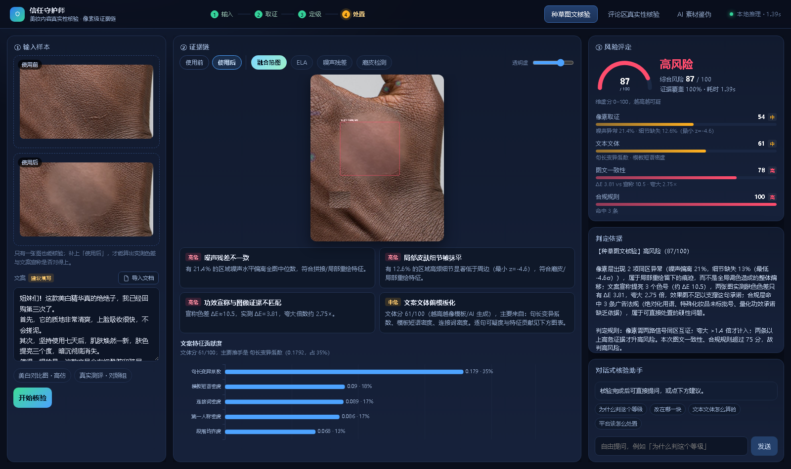
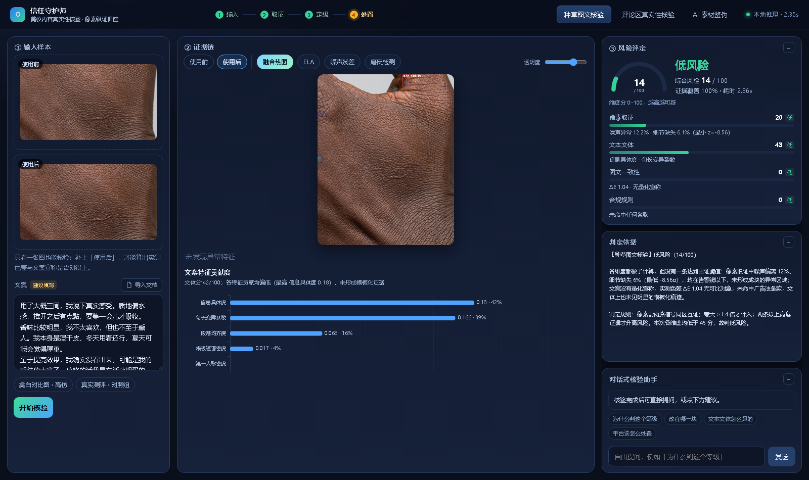
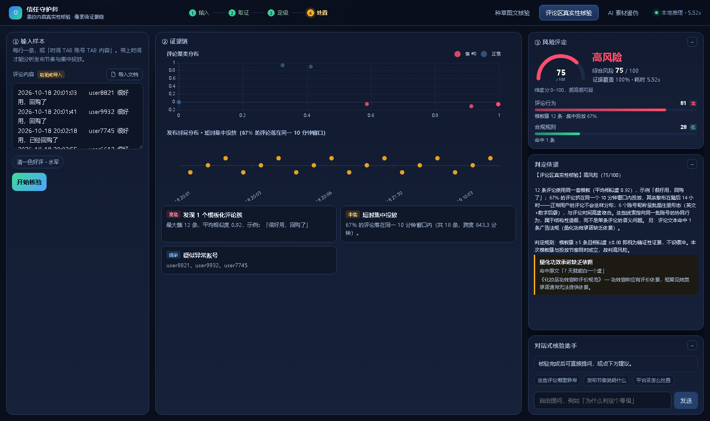
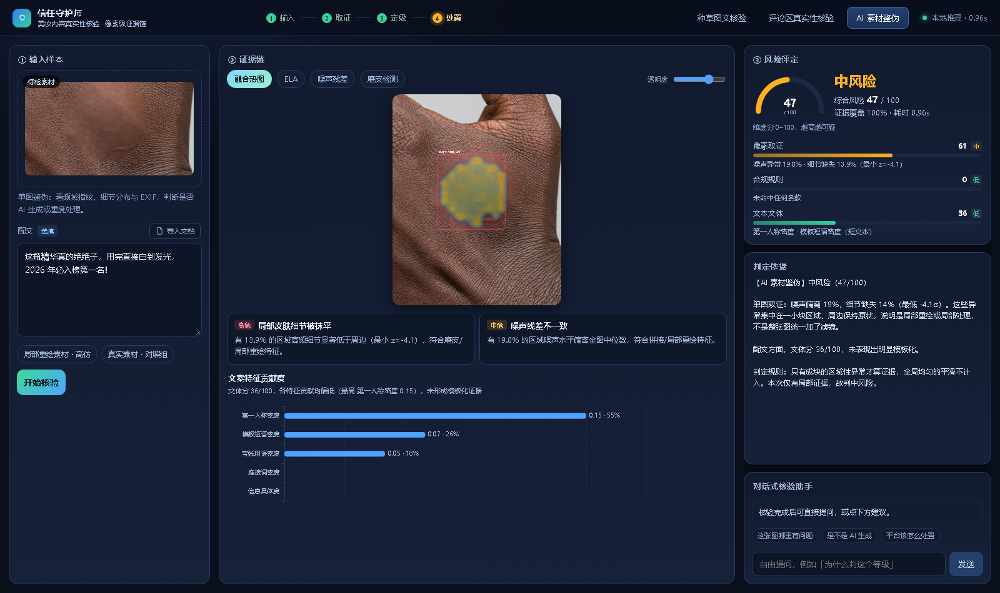

# 信任守护师 · 让「眼见为实」重新变得可验证

> 一个基于**像素级证据链**的美妆内容真实性核验 Agent。
> 它不只判断「像不像假的」，而是给出「**哪一块、凭什么、违反了哪一条**」。



> 欧莱雅第二届美妆科技黑客松 · 天池 532496 · 赛题 2 · 初赛作品

---

## 这是什么

美妆内容是「AI 造假」的重灾区：文案可以是 AI 写的，对比图可以是磨皮拼出来的，
评论区可以是刷出来的。平台审核员每天面对这些内容，可用的工具却只有一个「举报」按钮。

本项目不是又一个「AIGC 概率」黑盒，而是一条**可追溯的证据链**：

- 每个结论挂载**可核对的数值**（21.4% 的区域噪声异常、ΔE 3.81 vs 宣称 10.5）
- 篡改区域**画在图上**，边界可以放大看
- 证据不足时**主动降级 / 标注「未参与」**，而不是硬给高分
- 多个独立证据互相印证时才升级到高风险
- 命中的法规条款**可直接抄进处置工单**

纯 CPU、可离线运行，单次分析 2–4 秒。

---

## 三个场景

| 场景 | 造假方式 | 取证手段 |
|---|---|---|
| **种草图文** | 局部磨皮、提亮、拼接对比图 | ELA 压缩误差 · 噪声残差 · 高频细节缺失 · 频域 · SIFT 拷贝-移动 · EXIF |
| **评论区** | 模板化水军、短时集中投放 | 模板簇聚类 · 短时爆发比 · 情感一致性 · 账号画像 |
| **AI 素材** | 局部重绘、生成图、重度处理 | 频域幂律斜率 · 细节分布 · 局部一致性 |

### 三个场景的真实输出

<table>
<tr>
<td width="50%"></td>
<td width="50%"></td>
</tr>
<tr>
<td align="center"><sub>高仿对比图 · 高风险 87/100 · 热图落在磨皮区域</sub></td>
<td align="center"><sub>真实测评对照 · 低风险 14/100 · 热图几乎为空</sub></td>
</tr>
</table>

<table>
<tr>
<td width="50%"></td>
<td width="50%"></td>
</tr>
<tr>
<td align="center"><sub>评论区 · 12 条同模板 8 分钟投完 · 确证性证据</sub></td>
<td align="center"><sub>局部重绘素材 · 中风险 52/100 · 定位到重绘区域</sub></td>
</tr>
</table>

> 以上均为真实运行截图（`docs/images/`），未做美化。

---

## 30 秒跑起来

> **在线演示（只读）**：<https://lulu520-1314.github.io/trust-shield/>
> 这是预生成结果的静态版，5 组样例可切换查看；**不能上传自己的图片**，完整功能请按下面的方式本地运行。

```bash
# 1. 安装依赖（Python 3.10+，只需一次）
pip install -r requirements.txt

# 2. 启动（Windows 可直接双击 start.bat）
python -m uvicorn app.server:app --host 127.0.0.1 --port 8899

# 3. 浏览器打开
#    http://127.0.0.1:8899
```

首次启动约 5 秒（要加载 sklearn / pandas）。页面左侧有示例按钮，**无需自备素材**即可看到完整效果。

文案和评论支持直接粘贴，也可以点输入框右上角的「导入文档」，从 **`.txt` / `.md` / `.docx`** 读取正文（自动识别 UTF-8 / GBK 编码，`.docx` 里的表格也会被抽出来）；也可以把文件拖进输入框。单文件上限 8 MB、2 万字。

---

## 它是怎么工作的

```
输入（图片 + 文案 / 评论）
        │
        ▼
   ┌─────────┐
   │ 场景识别 │
   └────┬────┘
        │  并行取证
 ┌──────┼──────────┬──────────────┬──────────────┐
 ▼      ▼          ▼              ▼              ▼
像素层  语义层      行为层          一致性层        规则层
ELA    9 项文体   模板簇聚类      CIELAB 色差     广告法/条例
噪声残差 特征贡献   短时爆发比      ΔE vs 宣称      特殊化妆品
磨皮    逐句可疑度  情感一致性      光照方向差      功效宣称
频域/EXIF          账号画像
 └──────┴──────────┴──────────────┴──────────────┘
        │
        ▼
   多信号互证 + 加权融合 + 分级
        │
        ▼
  风险等级 · 证据清单 · 篡改热图 · 逐条法规 · 对话追问
```

**固定 DAG 编排，不用自由 ReAct**：演示现场不会出现循环调用、幻觉工具、耗时不可控。

### 两个关键设计

1. **多信号互证**：正常高纹理照片的 ELA 天然偏高，单信号必然误报。要求 ELA / 噪声 / 磨皮
   至少两路在同一区域同时异常，才认定为「证据确凿」的篡改区域。
2. **主动示弱**：维度算不出来时显示「未参与」而不是 0；覆盖率不足时结论自动降级。
   系统必须让用户知道它这次少看了哪一维证据。

---

## 分数怎么读

全站统一 **0–100**，分数越高越可疑：

| 分数 | 等级 | 处置建议 |
|---|---|---|
| 0–44 | 低风险 | 通过，纳入常规抽检 |
| 45–74 | 中风险 | 限流 + 要求补充功效依据 |
| 75–100 | 高风险 | 下架 + 转人工复核 |

维度分同样按 0–100 显示并标注 低/中/高：`像素取证` `文本文体` `图文一致性` `合规规则` `评论行为`。

---

## 评测

在自建 **50 条测试包**（伪造 28 / 真实 22，含 ground-truth mask）上的结果：

| 指标 | 数值 |
|---|---|
| Precision | 0.77 |
| Recall | 0.46 |
| F1 | 0.58 |
| 定位 IoU | 0.23 |
| 分场景 F1 | 图文 0.63 / 评论 0.93 / 素材 0.00 |

复现：`python eval/run_eval.py`

**一次如实记录的修复。** 早期版本 F1 是 0.69，其中素材场景的 0.53 主要来自 ELA 的 z 分数：
当画面足够均匀时 MAD 退化为 0，除以 `1e-6` 会把微小波动放大成 `z=876445` 这种天文数字，
真实照片因此被误判成「重压缩台阶」。补上绝对幅度闸门（起伏 < 1.5 灰阶不算台阶）后，
素材场景的虚高检出消失，F1 回落到 0.58——**这个数字不好看，但它是真的**。

**已知短板（不掩饰）**：

- 素材场景在自建集上**没有区分度**（伪造与真实的 ELA 幅度中位数 0.93 vs 0.94），
  目前只能作为辅助筛查，不作为独立结论；
- 极端微距、整体调色类修图召回偏低；
- 同一画面被复用作「前后对比」时仍会误报。

定位 IoU 中位数是 0，但这不是「框歪了」——是**没出框**（整条判为低风险，没有定位输出）。
真正出框的 4 个样本 IoU 在 0.59–0.76。

下一步：接入开源预训练 AIGC 检测器做集成，并用真实平台数据重新标定阈值。

---

## 项目结构

```
app/
  server.py           FastAPI 服务（页面 + 分析 + 问答）
  core.py             编排、证据融合、风险分级、结论生成
  qa.py               基于证据的问答（11 类意图 + 关键词检索兜底）
  tools/
    pixel.py          像素取证（7 维度 + 块级融合定位）
    semantic.py       文体特征（9 项 + 贡献度分解）
    behavior.py       评论区（聚类 / 时间 / 账号）
    consistency.py    图文一致性（CIELAB 色差 + 光照方向）
    rules.py          美妆广告合规规则
    imgio.py          Unicode 路径安全的图片读写
  web/                前端（原生 HTML/CSS/JS，无构建步骤）
data/
  samples/            界面一键示例
  test_package/       50 条测试数据包（含 mask 与 meta）
  raw/                原始素材（来源见 data/raw/README.md）
eval/run_eval.py      评测脚本
scripts/              样本生成 / 数据包生成 / PPT 生成 / UI 巡检
docs/                 技术方案、实现状态、故障排查、截图
deliverables/         初赛三件套（PPT / 视频脚本 / 提交清单）
```

---

## 工程校验

```bash
# UI 全流程自动巡检（17 项断言 + JS 异常捕获）
node scripts/audit_ui.mjs

# 边界输入（空输入 / 超短文本 / 无时间戳 / 否定语境 / 单图）
python scripts/test_edge.py

# 对照用例（高仿 vs 真实 的判定是否拉开）
python scripts/verify_cases.py
```

最近一次：**17 项全通过，0 个 JS 异常，0 个资源错误**。

---

## 文档

| 文档 | 内容 |
|---|---|
| [docs/技术方案.md](docs/技术方案.md) | 完整设计：算法、阈值、架构、数据与评测方案 |
| [docs/实现状态与调参记录.md](docs/实现状态与调参记录.md) | 哪些设计实现了、哪些没有，以及为什么这么调 |
| [docs/故障排查.md](docs/故障排查.md) | 已知问题、修复记录、复现方法 |
| [使用指南.md](使用指南.md) | 界面操作、输入格式、常见疑问 |
| [docs/在线部署.md](docs/在线部署.md) | 想在公网地址上也能上传图片？部署到 Render 的步骤 |

---

## 数据与合规

- 图片素材来自 Wikimedia Commons 的公开皮肤特写照片（**不含可识别的真人面部**），
  经程序二次编辑用于方法验证，来源与许可见 [data/raw/README.md](data/raw/README.md)
- 文案为自建，不对应任何真实商品
- 系统使用**传统取证算法 + 规则引擎**，不依赖闭源大模型 API，可离线运行
- 若用于真实业务，请自行完成算法备案与内容审核合规评估

## License

代码以 [MIT](LICENSE) 许可发布；`data/` 下的图片素材遵循其原始许可（见 `data/raw/README.md`）。
